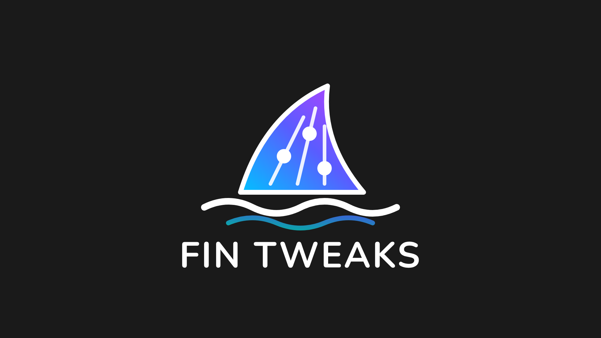

# Jellyfin Fin Tweaks Plugin

**Fin Tweaks** is a small Jellyfin plugin for small fixes to the web client. Each tweak is a short script with its own toggle in the admin settings: turn on the ones you want, and the rest never reach the browser. *Fin* as in Jelly**fin**, and as in a fish fin: small, but it steers.

It is the companion of [Home Screen Sections Encore](https://github.com/ApenasAngelo/jellyfin-plugin-home-sections-encore) and [Media Bar Encore](https://github.com/ApenasAngelo/jellyfin-plugin-media-bar-encore): bigger features live in those plugins, quick fixes live here.

## Tweaks

| Tweak | What it does | Status |
|---|---|---|
| Global search | The search button always searches the whole server, instead of only the library you are browsing | planned |

## How it works

- Scripts are added to the web client at request time through the [File Transformation](https://github.com/IAmParadox27/jellyfin-plugin-file-transformation) plugin: nothing is written to Jellyfin's files on disk.
- Only enabled tweaks are served, one file per tweak.
- Configuration is admin-only (**Dashboard → Plugins → Fin Tweaks**); users never see a settings page.
- Works in the browser, in Jellyfin Desktop and in the mobile apps that use the web client. Native TV apps do not load web scripts.

## Installation

1. Install [File Transformation](https://github.com/IAmParadox27/jellyfin-plugin-file-transformation) (required).
2. In Jellyfin, go to **Dashboard → Plugins → Repositories** and add
   `https://raw.githubusercontent.com/ApenasAngelo/jellyfin-plugins/main/manifest.json` (releases are not published yet).
3. Install **Fin Tweaks** from the **Catalog** and restart Jellyfin.
4. Turn on the tweaks you want in **Dashboard → Plugins → Fin Tweaks** and refresh the browser.

## Requirements

- Jellyfin 12.4.
- File Transformation.

## Build The Plugin By Yourself

1. Clone the repository.
2. Build with the .NET 10 SDK (in a container is fine, e.g. `mcr.microsoft.com/dotnet/sdk`) and copy the output to Jellyfin's `plugins` folder.

## Credits

Thanks to [IAmParadox27](https://github.com/IAmParadox27) for the [File Transformation plugin](https://github.com/IAmParadox27/jellyfin-plugin-file-transformation), and to the Jellyfin plugin community ([n00bcodr](https://github.com/n00bcodr), [CodeDevMLH](https://github.com/CodeDevMLH)) whose plugins showed the way.

Licensed under the GNU GPL v3.
